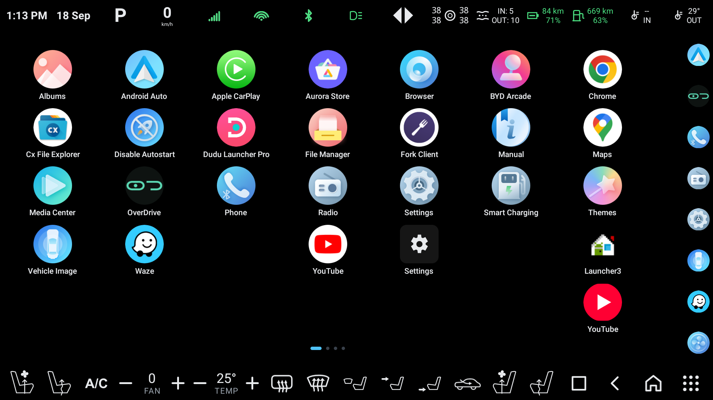
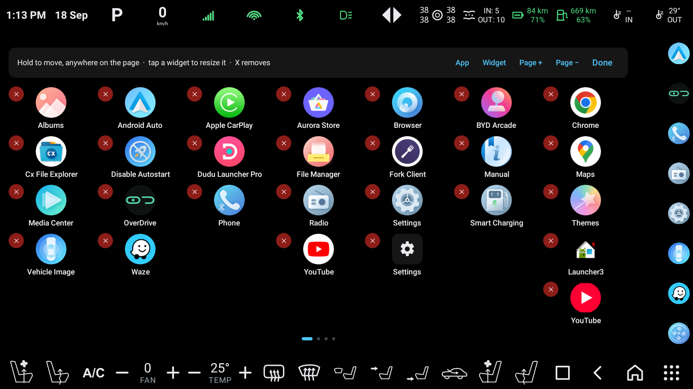
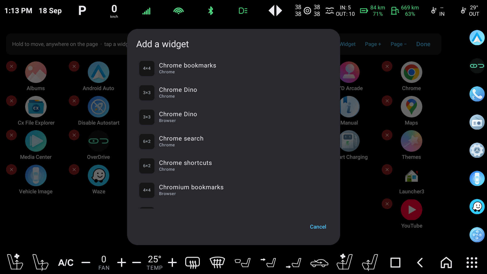
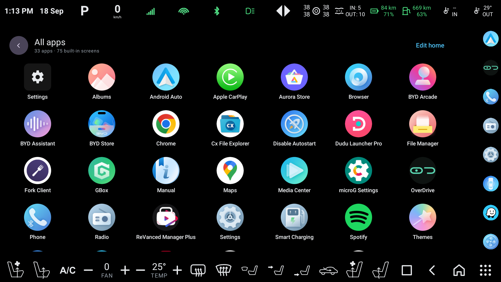
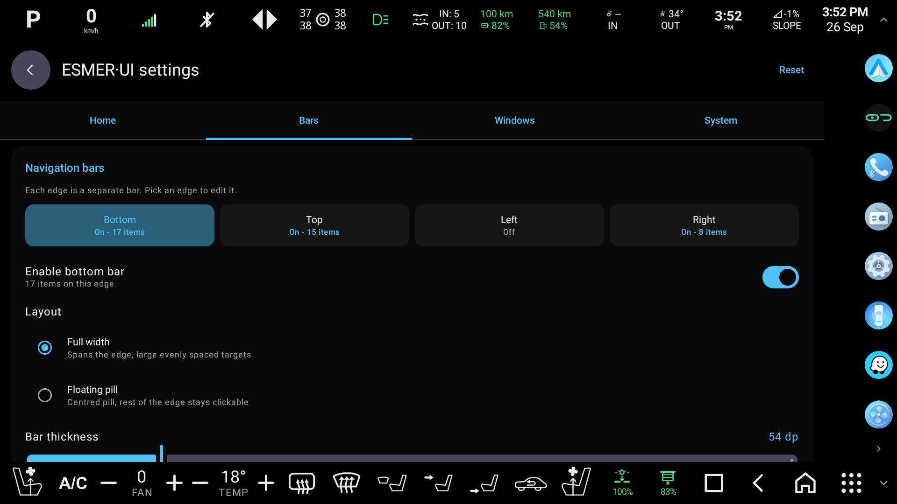
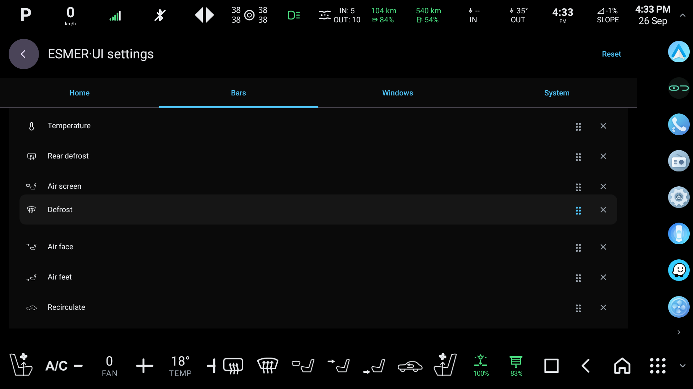

# ESMER·UI

A custom Android launcher for **BYD DiLink 3.0** head units.

The stock launcher gives you a grid and BYD's own bars. ESMER·UI replaces both: a
home screen you arrange yourself, and up to four configurable bars docked to the
edges of the display carrying navigation buttons, climate controls and live
readouts pulled straight off the car's own bus.

Built and tested on a 1920×1080 @ 240dpi DiLink 3.0 unit running Android 10
(SDK 29).



*The top and bottom bars, the left and right rails, and the grid between them are
all ESMER·UI. Readouts across the top are live from the car — gear, speed, tyre
pressures, ranges, cabin air.*

---

## What it does

**Home screen**

- Free placement: any icon anywhere on the grid, gaps included — nothing is packed
- Drag to move, drag past an edge to cross pages
- Android widgets, hosted and resizable by the cell
- Add and remove pages
- An app drawer listing everything on the unit, including the `MAIN` activities with
  no `LAUNCHER` category that no launcher normally shows (BYD's climate panel, radio,
  camera and diagnostic screens — 75 of them on this car)

Long press to arrange. Drag anything anywhere; `X` removes; `App`, `Widget` and
`Page +` add.



Widgets are hosted through `AppWidgetHost`, listed with the span each provider asks
for, and resizable by the cell once placed.



The drawer lists the lot — tap to launch, or switch to `Edit home` and tap to add.



**Edge bars**

Up to four bars — top, bottom, left, right — each independently enabled, sized and
populated. They are overlay windows hosted by the accessibility service, which the
platform layers above the head unit's own bars, so they persist over other apps and
sit over BYD's bars without those having to be hidden. Any docked bar folds away to
a tab in its corner and comes back with a tap.

Each bar holds any mix of:

- Navigation: Back, Home, Recents, All apps
- Volume up / down / mute
- Climate: temperature and fan steppers, A/C, recirculate, front and rear defrost,
  per-vent airflow, seat heating and ventilation, steering wheel heat
- Body: sunroof, sunshade, each window or all four, tailgate — one press opens, the
  next stops the panel where it is (the tailgate command is untested on this car)
- Head-up display: on/off, navigation and ADAS content, theme, brightness, height
- App shortcuts
- Live readouts (below)

Each bar is set up on its own tab in settings: which edge, full width or floating
pill, thickness, icon size, and the ordered list of what it carries — drag a row by
its handle to reorder.





**Live readouts, direct from the car**

Clock, date, gear, road speed, road slope, headlight beam, indicators, tyre
pressures (bar, psi or kPa), electric and fuel range with charge and tank
percentages, inside and outside temperature, cabin and outside PM2.5, plus Wi-Fi,
cellular and Bluetooth strength.

Values are read from BYD's automotive bus directly — no dependency on any other
app being installed or running.

**Projection to the cluster**

The Cluster tab casts any app onto the instrument cluster behind the wheel and shows
a live mirror of it on the head unit, which you tap and swipe to drive the app. Pick
the app, press `Project to cluster`; `Stop` hands the dial back to the car.

- **Floating mirror** — `Float the mirror` (or a `Cluster mirror` bar button) opens the
  live mirror as a draggable, resizable window over whatever is on screen, so the
  cluster app can be answered without leaving the one you are in. Back goes to the
  cluster app; its place and size are remembered.
- **Cluster window** — Full, Left half, Right half, Center, or `Resize` to drag a frame
  on the preview to any size and position; `Keep cluster aspect` locks the frame to
  the dial's 8:3 shape. The halves are docked windows and anything else is a slot (a
  window of that size on the cluster carrying its own small display), so none of them
  shows the ROM's freeform caption bar.
- **Readouts on the cluster** — the launcher's own readouts (clock and date, gear,
  speed, headlights, tyre pressures, ranges, temperatures, air quality, slope) drawn
  on the dial beside the cast app, with the car's own icons untouched. Pick which,
  stack them or set them in a row, and `Move` to drag the frame on the preview; its
  width sets their size.
- **Mirror scaling** — Fit, Stretch or Zoom for how the 1920×720 image fills the
  preview and the floating window.
- **Auto-start on power-on** — casts the last-used app again each time the car powers
  on. A `Cast to cluster` bar button starts or stops it by hand.

On this unit the cluster is a second OS on the same chip, and the head unit publishes
its projected layer as a 1920×720 display that only an allowlisted caller may switch
the dial over to. The launcher therefore talks to the unit's own wireless ADB on
`127.0.0.1:5555` with a key of its own, sends the container the projection codes from
there, launches the app on that display, and starts a small shell-level helper
(`app_process`, uid 2000) that mirrors the display into the preview and injects the
preview's touches back. The first time, the unit asks *Allow USB debugging?* — tap
Allow with *Always allow from this computer* ticked. The sequence of container
codes is the one [BYD-DashCast](https://github.com/Kiroha/byd-dashcast) worked out
(MIT); the implementation here is the launcher's own.

Apps that mark their window secure (Chrome's incognito tabs, DRM video) render black
on the mirror, as on any screen capture.

---

## How the car is read

BYD's `BYDAutoDeviceManager` exposes a generic feature bus: every signal has an
integer id, read with `getInt`/`getDouble` and written by setting the matching
`_SET` id. Unlike the per-device wrappers (`BYDAutoAcDevice` and friends) it is
**not** gated behind the signature-level `BYDAUTO_*_GET` / `_SET` permissions.

Signal ids live in `BYDAutoFeatureIds$<Group>` and are assigned in the class
initialiser, so they can only be read from a running VM — hence the reflection in
[`BydFeatures`](app/src/main/java/com/example/esmerui/car/BydFeatures.kt).

Two things make this harder than it looks:

**The bus never returns an error.** A signal the car does not carry comes back as an
ordinary integer. Three values mean "nothing here" — `65535`, `-10011` (not fitted)
and `-10013` — and taking one at face value is how a readout ends up claiming
65,535 km of range.

**`-10013` usually means "wrong type".** The bus has a `getDouble` beside its
`getInt`, and asking `getInt` for a double-typed signal returns `-10013`,
indistinguishable from a signal the car genuinely has nothing for. Of 150 signals
that answered that way on this car, 84 answer as doubles — road speed among them.
Probe every new signal with both.

**Encodings are measured, not assumed.** Seat climate counts from one, so `1` means
off. The indicators use a single combined signal where `2` is left and `4` is right,
and it follows the lamp, so it blinks. Gear position lives in
`GEARBOX_AUTO_MODE_TYPE` — a name that reads like a description of the gearbox —
while both signals with "gear" in the name answer "not fitted".

A sweep of every declared signal can be dumped on demand:

```
adb shell am broadcast -a com.example.esmerui.SWEEP -p com.example.esmerui
# ~50 s later
adb pull /sdcard/Android/data/com.example.esmerui/files/bus-scan.txt
```

Any signal can be traced live while you operate the car, which is how the
encodings above were settled:

```
adb shell am broadcast -a com.example.esmerui.WATCH -p com.example.esmerui \
  --es signals Gearbox.GEARBOX_AUTO_MODE_TYPE,Speed.SPEED_AUTO_SPEED \
  --ei hz 5 --ei seconds 60
adb logcat -s BusWatch
```

---

## Building

Requires JDK 17+ (Android Studio's bundled JBR works) and the Android SDK.

```
./gradlew assembleDebug
```

The debug build is shrunk with R8 — tree-shaking only, names and line numbers kept,
still debuggable. That takes the dex from ~29 MB to ~7 MB, which matters on a head
unit where the whole process otherwise sits mapped in memory.

---

## Setting it up on the unit

Install — the signed APK from the [latest release](https://github.com/akyuznet/ESMER-UI/releases/latest),
or your own build — then grant the pieces that cannot be granted from the UI:

```
adb install -r ESMER-UI-1.2.apk

# Hide BYD's own navigation and status bars
adb shell pm grant com.example.esmerui android.permission.WRITE_SECURE_SETTINGS

# Host widgets without a confirmation dialog per widget
adb shell appwidget grantbind --package com.example.esmerui --user 0
```

Then, on the unit:

- **Draw over other apps** — required for the bars
- **Accessibility service** — required for Back and Recents

Set it as the default home app from launcher settings, or from the reminder that
appears on the home screen.

> Some units ship another launcher that rewrites the enabled-accessibility-services
> list to just itself, which silently kills Back and Recents. ESMER·UI watches that
> setting and re-asserts itself when it changes.

---

## Notes

- `targetSdk` is 37 but the unit is API 29; the code paths that need it check
  `Build.VERSION.SDK_INT`.
- Overscan (`IWindowManager.setOverscan`, reflected) is used to reserve the screen
  edges so other apps do not draw under the bars. That API exists on Android 10 only.
- Idle cost on the unit is roughly 1% of one core and ~50 MB PSS.
- Cluster projection needs the unit's ADB over TCP, which DiLink 3 keeps enabled
  (`persist.sys.adb.wiress.enable`). The helper's log is
  `/data/local/tmp/esmerui_cluster.log`; debug builds take
  `am broadcast -a com.example.esmerui.PROJECT -p com.example.esmerui --es component <pkg/.Activity>`
  (or `--ez stop true`, `--es placement LEFT_HALF`, `--es scaling ZOOM`, `--ez float true`,
  `--ez capture true` for a PNG of the cluster in `/data/local/tmp`) to drive it from adb.

## Community

Questions, bug reports and what your car answers on the bus: the
[ESMER·UI WhatsApp group](https://chat.whatsapp.com/FITclsqasVO7fxmVBlJ8gX?s=cl&p=a&ilr=4&iam=1),
or [GitHub issues](https://github.com/akyuznet/ESMER-UI/issues).

## Licence

[MIT](LICENSE). Do what you like with it; no warranty.

It talks to a car. Read the vehicle notes above before trusting a reading, and
test changes with the vehicle parked.
